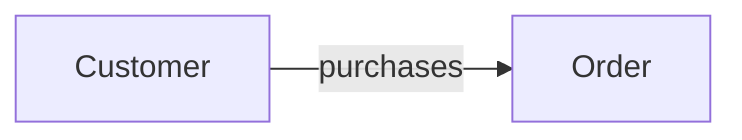
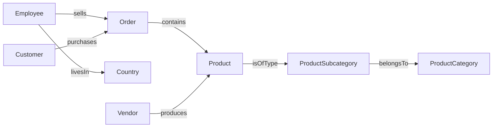
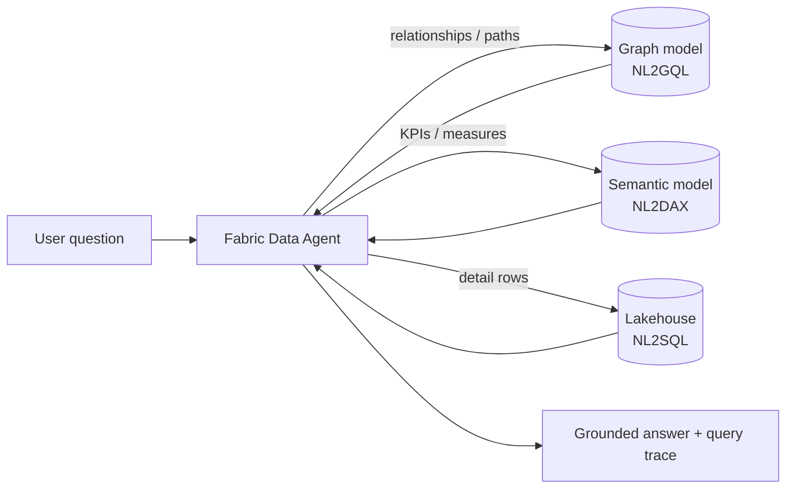

# The Power of Graph for a Knowledge Base
### Microsoft Fabric Graph · GQL · Fabric Data Agent

> Companion repository for the session **"The Power of Graph for a Knowledge Base"**.
> It explores the main benefits of graph in Microsoft Fabric, how it answers in-depth business questions that are hard to answer with a traditional semantic model, and how a graph can become the knowledge source of an AI agent.


---

## Table of contents

1. [Why graph?](#1-why-graph)
2. [Repository structure](#2-repository-structure)
3. [Prerequisites](#3-prerequisites)
4. [Level 1 – Quickstart (Customer → Order)](#4-level-1--quickstart-customer--order)
5. [Level 2 – Full Adventure Works graph](#5-level-2--full-adventure-works-graph)
6. [Level 3 – Business questions in GQL](#6-level-3--business-questions-in-gql)
7. [Level 4 – Programmatic access (REST API)](#7-level-4--programmatic-access-rest-api)
8. [Level 5 – Graph as an agent knowledge base](#8-level-5--graph-as-an-agent-knowledge-base)
9. [Graph vs semantic model – when to use what](#9-graph-vs-semantic-model--when-to-use-what)
10. [Known limitations](#10-known-limitations)
11. [Roadmap – next steps to make this project robust](#11-roadmap--next-steps-to-make-this-project-robust)
12. [References](#12-references)

---

## 1. Why graph?

Most analytical questions are about **numbers** (how much, how many, trend). Some of the most valuable questions are about **connections**:

- *Customers who bought X — what else did they buy?*
- *If vendor V stops supplying, how many customers are affected?*
- *How is customer A connected to customer B?*
- *Which salespeople, in which countries, drive which product categories?*

In a relational or semantic model, these questions become self-joins, bridge tables, many-to-many relationships and complex DAX. In a graph, relationships are **first-class citizens**: queries *follow edges* instead of computing joins, and the cost of a traversal depends on the local neighbourhood touched, not the size of the whole dataset.

**Graph in Microsoft Fabric** brings this natively to the platform:

| Capability | What it means |
|---|---|
| Runs on **OneLake** | Nodes and edges are mapped over lakehouse tables — no separate graph database, no ETL copy |
| **Labeled property graph** | Nodes and edges carry labels and properties |
| **GQL (ISO/IEC 39075)** | Standard graph query language — same ISO body as SQL |
| Visual + code querying | Query builder for analysts, code editor for GQL |
| **NL2GQL + Fabric Data Agent** (preview) | Natural-language questions answered by deterministic graph traversals |
| Fabric governance | Workspace RBAC, OneLake security, Capacity Units (no extra licence) |

---

## 2. Repository structure

```
fabric-graph-knowledge-base/
├── README.md
├── model/
│   └── graph-model.md                 # Node & edge specification (labels, tables, keys)
├── notebooks/
│   ├── 01_load_and_validate_data.py   # Load ALL sample folders to Delta + data-quality checks
│   └── 02_query_graph_via_api.py      # Run GQL from a notebook through the REST API
├── gql/
│   ├── 01_quickstart.gql              # Quickstart query
│   ├── 02_exploration.gql             # Profiling the full graph
│   ├── 03_business_questions.gql      # Multi-hop questions (the core of the session)
│   └── 04_advanced_patterns.gql       # Variable-length paths, shortest path, OPTIONAL MATCH, NEXT
├── agent/
│   ├── agent-instructions.md          # Agent-level instructions
│   ├── datasource-graph.md            # Graph data source description + instructions
│   ├── example-queries.json           # NL → GQL pairs to teach the agent
│   └── evaluation/golden-questions.csv# Test set to evaluate agent answers
├── scripts/
│   └── query-graph.sh                 # Query the graph from the command line (az CLI)
└── docs/
    ├── graph-vs-semantic-model.md     # The argument of the session
    └── session-flow.md                # Demo script for the talk
```

---

## 3. Prerequisites

- Microsoft Fabric capacity **F2 or higher**, or a [Fabric trial](https://learn.microsoft.com/fabric/fundamentals/fabric-trial)
- Graph available in your [region](https://learn.microsoft.com/fabric/graph/overview#region-availability) (e.g. West Europe, North Europe, UK South…)
- A workspace where you can create items
- Sample data: `adventureworks_docs_sample.zip` from [microsoft/fabric-samples › docs-samples/graph](https://github.com/microsoft/fabric-samples/tree/main/docs-samples/graph)
- *(Level 4)* Azure CLI (`az login`) or a Fabric notebook
- *(Level 5)* Fabric Data Agent enabled in your tenant

> ⚠️ Access to a graph is **scoped to its workspace**. Users inside the workspace with access to the underlying lakehouse data can model and query it.

---

## 4. Level 1 – Quickstart (Customer → Order)

Based on the official [quickstart](https://learn.microsoft.com/fabric/graph/quickstart) (~15 min).

1. **Create a lakehouse** `AdventureWorksLakehouse` — *untick "Lakehouse schemas"*.
2. **Upload** the extracted sample folder to `Files`.
3. **Load to tables** (parquet): `adventureworks_customers`, `adventureworks_orders`.
4. **Create a Graph model** `AdventureWorksGraph` → *Get data* → select both tables.
5. **Add node** `Customer` — table `adventureworks_customers`, key `CustomerID_K`, add all columns.
6. **Add node** `Order` — table `adventureworks_orders`, key `SalesOrderDetailID_K`, add all columns.
7. **Add edge** `purchases` — table `adventureworks_orders`, `Customer` (`CustomerID_FK`) → `Order` (`SalesOrderDetailID_K`).
8. **Save** and wait for **Data load completed**.
9. **Query mode → Code editor**:

```gql
MATCH (c:Customer)-[:purchases]->(o:`Order`)
RETURN c.fullName AS customer_name, count(o) AS num_orders
GROUP BY customer_name
ORDER BY num_orders DESC
LIMIT 5
```



> 💡 Note: this query groups by `fullName`. Two customers with the same name would be merged — in production, group by the key (`CustomerID_K`) and return the name as a label (see `gql/03_business_questions.gql`).

---

## 5. Level 2 – Full Adventure Works graph

Going beyond the quickstart: model **all** entities and relationships (as in the [full tutorial](https://learn.microsoft.com/fabric/graph/tutorial-introduction)), including a node **derived from a column** (`Country` from the employees table).

👉 Instead of loading tables one by one, run [`notebooks/01_load_and_validate_data.py`](notebooks/01_load_and_validate_data.py): it loads every sample folder to Delta **and checks key uniqueness and orphan foreign keys** before you build the graph (a broken key = a missing edge).



Full specification (tables, keys, properties): [`model/graph-model.md`](model/graph-model.md).

---

## 6. Level 3 – Business questions in GQL

This is the heart of the session: questions that need **several hops** and are awkward in a star schema.

| # | Business question | Hops | File |
|---|---|---|---|
| 1 | Customer ↔ category affinity | 4 | `03_business_questions.gql` |
| 2 | Customers who buy across most categories (cross-sell profile) | 4 | `03_business_questions.gql` |
| 3 | "Customers who bought X also bought…" (co-purchase) | 4 (fan-out + fan-in) | `03_business_questions.gql` |
| 4 | Supply concentration: subcategories with fewest vendors | 2 | `03_business_questions.gql` |
| 5 | Vendor impact: customers affected if a vendor fails | 3 | `03_business_questions.gql` |
| 6 | Salesperson country × category reach | 5 | `03_business_questions.gql` |
| 7 | Products never ordered (OPTIONAL MATCH) | 1 | `04_advanced_patterns.gql` |
| 8 | How are two customers connected? (ANY SHORTEST) | 1–6 | `04_advanced_patterns.gql` |

Example — **vendor impact** (supply-chain risk):

```gql
MATCH (v:Vendor)-[:produces]->(p:`Product`),
      (c:Customer)-[:purchases]->(o:`Order`)-[:`contains`]->(p)
LET vendor = v.vendorName
RETURN vendor,
       count(DISTINCT c) AS customers_impacted,
       count(DISTINCT p) AS products,
       count(o)          AS order_lines
GROUP BY vendor
ORDER BY customers_impacted DESC
LIMIT 10
```

---

## 7. Level 4 – Programmatic access (REST API)

The graph exposes a single **GQL Query API** endpoint:

```
POST https://api.fabric.microsoft.com/v1/workspaces/{workspaceId}/graphModels/{graphModelId}/executeQuery?beta=true
Body: { "query": "MATCH (n) RETURN n LIMIT 10" }
```

- [`scripts/query-graph.sh`](scripts/query-graph.sh) – run any `.gql` file from the command line with `az rest`.
- [`notebooks/02_query_graph_via_api.py`](notebooks/02_query_graph_via_api.py) – run GQL from a Fabric notebook, convert the result to a Spark DataFrame and **persist it to a Delta table** (e.g. a "co-purchase" table that a Power BI report can consume — today Power BI can't connect directly to a graph).

> The query parameter has changed during preview (`preview=true` / `beta=true`). Check the [GQL Query API](https://learn.microsoft.com/fabric/graph/gql-query-api) page for the current value — it's configurable in both files.

---

## 8. Level 5 – Graph as an agent knowledge base

Fabric Data Agent supports **Graph (preview)** as a data source. Under the hood an **NL2GQL** service interprets the question, validates it against the graph model, generates GQL and runs a **deterministic traversal** — the answer is grounded in the graph and the generated GQL is inspectable.



**Setup**

1. Create a **Data agent** item in the workspace.
2. Add the graph model `AdventureWorksGraph` as a data source.
3. Paste [`agent/agent-instructions.md`](agent/agent-instructions.md) into *Agent instructions*.
4. Paste the description and instructions from [`agent/datasource-graph.md`](agent/datasource-graph.md) into the graph data source settings.
5. Add the NL→GQL pairs from [`agent/example-queries.json`](agent/example-queries.json) as *Example queries*.
6. Test with [`agent/evaluation/golden-questions.csv`](agent/evaluation/golden-questions.csv) and check the GQL trace for each answer.

**Going further (multi-source agent):** add the semantic model (for KPIs like revenue/margin) next to the graph (for relationships), and let the agent instructions route each question to the right source.

> Note: a graph data source can't be scoped to specific nodes/edges — the agent sees the whole model, so the **instructions and examples do the heavy lifting**.

---

## 9. Graph vs semantic model – when to use what

| Question type | Semantic model (DAX) | Graph (GQL) |
|---|---|---|
| Aggregations, KPIs, time intelligence | ✅ Best fit | ⚠️ Possible, not the goal |
| Fixed star-schema slicing | ✅ | ⚠️ |
| Multi-hop (4–6 relationships) | ⚠️ Long relationship chains, ambiguity | ✅ Natural pattern |
| Co-purchase / "also bought" | ❌ Self-join of the fact table, heavy DAX | ✅ Two patterns sharing a node |
| Unknown / variable depth (paths) | ❌ | ✅ `{1,n}` quantifiers, shortest path |
| Many-to-many networks | ⚠️ Bridge tables | ✅ Native |
| Agent reasoning over connections | ⚠️ | ✅ NL2GQL with traceable traversals |

**They are complementary, not competitors.** Details: [`docs/graph-vs-semantic-model.md`](docs/graph-vs-semantic-model.md).

---

## 10. Known limitations

Checked against the [Current limitations](https://learn.microsoft.com/fabric/graph/limitations) page — verify before production:

- **No schema evolution**: adding properties or changing labels/edge types requires re-ingesting into a new model → version your models.
- **Sources**: OneLake and Mirrored Databases only. `MapType`/`StructType` not supported; `DATE` is not yet a runtime type (cast to `ZONED DATETIME` or string).
- **Query API**: 20-minute timeout, 64 MB response cap, no continuation for truncated rows → always filter/`LIMIT`.
- **GQL**: no `INSERT/UPDATE/DELETE`, no `$parameters`, no `ALL SHORTEST`, no `EXCEPT/INTERSECT`, only the simple form of `CASE`.
- **No export** of results and no direct Power BI connection to the graph (workaround: notebook → Delta, see Level 4).
- **Cost**: compute billed on uptime (10 CU-s per second, auto-shutdown when idle) + minimum 100 GB of OneLake cache storage.

---

## 11. Roadmap – next steps to make this project robust

### Phase 1 – Foundation ✅
- [x] Quickstart: `Customer -purchases-> Order`
- [x] Full Adventure Works model (8 node types, 7 edge types incl. derived `Country` node)
- [x] Library of business questions in GQL

### Phase 2 – Data engineering hardening
- [ ] **Medallion layout**: Bronze (raw parquet) → Silver (typed, deduplicated) → **Gold "graph-ready" tables** (one table per node type and per edge type, explicit keys, only the properties the graph needs).
- [ ] **Data-quality gate** before every graph refresh: key uniqueness, orphan FKs, nulls in keys, unsupported types (extend `01_load_and_validate_data.py` and fail the pipeline on errors).
- [ ] **Orchestration**: Data Pipeline → notebook (validate) → graph refresh, scheduled.
- [ ] **Naming conventions**: `PascalCase` node labels, `camelCase` verb edges (`purchases`, `belongsTo`), avoid reserved words (that's why `` `Order` `` needs backticks).

### Phase 3 – Lifecycle & governance
- [ ] **Model versioning** (`AdventureWorksGraph_v1`, `_v2`) since schema changes need a new model; document changes in a `CHANGELOG.md`.
- [ ] **Dev / Test / Prod workspaces** and Git integration / deployment pipelines (confirm current support for the Graph model item).
- [ ] **Security**: workspace roles, OneLake security on source tables; document who can model vs. who can query.
- [ ] **Cost monitoring** with the Fabric Capacity Metrics app (*Graph capacity usage CU* and *OneLake Cache*).

### Phase 4 – Richer knowledge graph
- [ ] Add **time** as a node or as edge properties (order date) to answer "how did these connections evolve?".
- [ ] Add **Geography** for customers (City → Country) to compare customer vs. salesperson geography.
- [ ] Add a second source (e.g. a mirrored database: support tickets, returns) to show cross-source relationships without ETL.
- [ ] Explore **graph algorithms** in Fabric data science (centrality, communities) to find influential products/customers.
- [ ] Explore **Fabric Ontology** (preview) to add business semantics on top of the graph.

### Phase 5 – Agentic knowledge base
- [ ] Multi-source Data Agent: **Graph** (relationships) + **Semantic model** (KPIs) + **Lakehouse** (detail).
- [ ] **GraphRAG hybrid**: add unstructured content (product docs, policies) via **Azure AI Search** as another agent source.
- [ ] **Evaluation harness**: run `golden-questions.csv` periodically, compare answers and the generated GQL, track accuracy over time.
- [ ] Expose the agent to users via **Microsoft Copilot Studio / Microsoft 365 Copilot** or **Azure AI Foundry**.

### Phase 6 – Consumption
- [ ] Persist key graph outputs (co-purchase pairs, vendor impact) to Delta and build a **Power BI report** on top.
- [ ] Small **web app / API** that calls the GQL Query API for real-time recommendations.

---

## 12. References

- [What is graph in Microsoft Fabric?](https://learn.microsoft.com/fabric/graph/overview)
- [Graph database concepts](https://learn.microsoft.com/fabric/graph/graph-database)
- [Quickstart](https://learn.microsoft.com/fabric/graph/quickstart) · [Full tutorial](https://learn.microsoft.com/fabric/graph/tutorial-introduction)
- [GQL language guide](https://learn.microsoft.com/fabric/graph/gql-language-guide) · [GQL conformance](https://learn.microsoft.com/fabric/graph/gql-conformance)
- [How graph works](https://learn.microsoft.com/fabric/graph/how-graph-works) · [Current limitations](https://learn.microsoft.com/fabric/graph/limitations)
- [GQL Query API](https://learn.microsoft.com/fabric/graph/gql-query-api)
- [Data Agent data sources](https://learn.microsoft.com/fabric/data-science/data-agent-add-datasources)
- [Graph-powered AI reasoning (preview) – Fabric blog](https://blog.fabric.microsoft.com/en-US/blog/graph-powered-ai-reasoning-preview/)
- [Sample data – microsoft/fabric-samples](https://github.com/microsoft/fabric-samples/tree/main/docs-samples/graph)

---

**Author:** André Ladislau — Microsoft Certified Trainer · Data & Analytics Solutions Architect

*Graph in Fabric and Data Agent graph support are evolving quickly (parts are in preview). Last reviewed: November 2026.*
